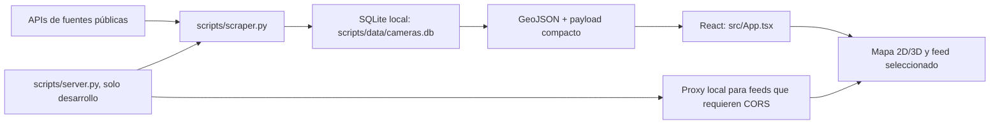

# NEXUS — análisis técnico

**Revisión:** 2026-11-12  
**Método:** lectura estática del código y pruebas manuales de la interfaz local
con el dataset incluido. Se probaron búsqueda/filtro por país, modos 2D/3D y un
fallo controlado de carga del chunk de detalle. No se ejecutaron scrapers,
sondeos de hosts ni feeds de cámaras. Como se proporcionó el árbol fuente
completo, el análisis siguió el código directamente; REA resulta más útil para
artefactos compilados o para comportamientos que el código disponible no
explique.

## Resumen

NEXUS es un explorador web de cámaras públicas y webcams: sitúa registros en un
mapa, filtra por país/sector y permite abrir la imagen, el vídeo o el reproductor
asociado a una cámara. No es un sistema de control de cámaras: el código revisado
consulta fuentes externas y muestra sus feeds; no contiene una función para
controlar cámaras ni una cuenta o backend de usuarios.

La aplicación tiene dos partes separadas:



El frontend consume archivos estáticos de `public/`; no invoca directamente los
plugins Python. El servidor de control es opcional, local y solo se usa para
sincronizar datos y para algunos feeds que el navegador no puede leer por CORS.

## Cómo funciona, de principio a fin

### 1. Ingesta y normalización

`scripts/scraper.py` es el punto de entrada de la CLI. Registra diez plugins:
Windy, Caltrans, NYC DOT, DriveBC, LTA Singapore, TfL London, NZTA, Iowa DOT,
Road511 USA y el puente de OpenCCTV. Cada plugin consulta su API y convierte sus
respuestas a una estructura GeoJSON común mediante `scripts/scrapers/utils.py`.
Los errores de una fuente no necesariamente detienen las demás.

Ejemplos observados en el código:

- `caltrans.py` lee los JSON de los doce distritos y omite registros fuera de
  servicio o sin coordenadas.
- `road511.py` pagina por estado, descarta feeds que el código conoce como
  inaccesibles y evita duplicar IDs dentro de esa ejecución.
- `windy.py` recorre una cuadrícula mundial; subdivide las áreas que alcanzan el
  límite de resultados de la API. Usa concurrencia acotada y un límite agregado
  de solicitudes. Requiere `WINDY_API_KEY`.
- `opencctv_bridge.py` usa el catálogo como índice de descubrimiento, solicita
  registros en lotes de hasta 50 y marca como no directamente mostrables los
  feeds que requieren proxies geográficos o no cumplen la regla `force_direct`;
  esos registros se conservan. No ejecuta un proxy residencial.
- `ipcamlive_resolver.py` convierte ciertos alias de catálogo en URLs HLS; el
  resolver de TxDOT transforma un identificador en una URL de imagen. Son
  adaptadores de formatos de origen, no análisis de vídeo.

El recolector puede ejecutarse con `--plugins`, `--all`, `--parallel` y otros
modos. Por defecto hace *upsert*; `--replace-source` sustituye lo de las fuentes
seleccionadas; `--fresh` vacía y reconstruye todo. La base SQLite está ignorada
por Git: en este checkout no está presente. Conectarse o ejecutar `--stats`
crea una base nueva si no existe.

### 2. Persistencia y exportaciones

`scripts/store.py` mantiene la tabla `cameras` en SQLite. Guarda campos comunes
en columnas e incluye propiedades adicionales en `props_extra`. La clave
principal es el ID de la fuente; las actualizaciones restablecen los indicadores
de fallos y reactivan la fila.

Al terminar, el pipeline escribe:

- `public/cameras.geojson`: colección completa y metadatos por fuente.
- `public/cameras.core.json`: coordenadas, banderas y códigos compactos.
- `public/cameras.labels.json`: nombres y ciudades.
- `public/cameras.detail/<n>.json`: URLs y detalles en grupos de 1.000 cámaras.
- `public/summary.json`: agregados para otros consumidores.

La división reduce el trabajo inicial del navegador: el mapa puede pintar con
coordenadas compactas; las etiquetas se cargan después y el detalle se pide al
abrir una cámara. Los archivos individuales se escriben con reemplazo atómico,
pero la familia completa de exportaciones no se publica como una sola unidad.

### 3. Mapa y feeds

`src/App.tsx` implementa el HUD, filtros, selección de cámara, configuración y
reproductores. La vista 2D usa Deck.GL sobre MapLibre; la vista 3D usa la
proyección globo de MapLibre. `src/binWorker.ts` agrupa puntos por píxel a bajo
zoom para reducir el trabajo de dibujo. El mapa se filtra por país y por las
banderas de disponibilidad antes de dibujar.

El frontend solo carga el bloque de detalle de una cámara seleccionada. Para
mostrar el feed intenta, según su tipo, una imagen, una solicitud JSON que
contiene una imagen, un `iframe`, MP4 o HLS con `hls.js`. El HLS intenta primero
la URL directa, luego el proxy local si está disponible y finalmente la
alternativa estática cuando existe.

**Límites de lo que indican los números y estados de la interfaz:**

- `live` se deriva de que exista `streamUrl`; no demuestra que el stream siga
  conectado hasta abrirlo.
- `directEligible` es una decisión importada o inferida del pipeline; tampoco es
  una prueba de disponibilidad actual.
- El dataset incluido reporta 229.308 filas, pero en la vista local observada el
  HUD mostró 218.028 nodos: 25.905 con URL de stream y 192.123 estáticos. La
  diferencia se excluye por las reglas de visualización; no se puede concluir
  solo por esa diferencia que todas esas cámaras estén desconectadas.
- El texto `System Status: Active` y la etiqueta `NEXUS v1.4.2 · Secure` son
  literales de la interfaz. No son un diagnóstico ni una versión tomada de
  `package.json` (que declara `0.0.0`).
- `Last Sync` se basa en el reloj local de la vista/feed, no en la fecha de
  actualización del dataset completo.

#### Comprobaciones runtime

Se ejecutó la interfaz local en `http://localhost:5173/`, sin iniciar el servidor
de control ni solicitar feeds de cámaras:

- El mapa renderizó en 2D y en modo globo 3D; el modo 2D se restauró al terminar.
- La búsqueda `United States` redujo la lista a Estados Unidos y sus territorios.
  Al elegir Estados Unidos, el HUD mostró 107.207 nodos (18.815 con URL de stream
  y 88.392 estáticos), mientras la lista de sectores mantuvo 110.913. El
  contador de sectores se calcula sobre el conjunto completo y no refleja el
  conjunto visible tras aplicar la elegibilidad de visualización. Además, el
  valor de la lista difiere en una unidad del 110.912 publicado en la tabla del
  README; conviene comprobar ambos contra el payload/fuente que los genera.
- Con un rechazo controlado de una solicitud `/cameras.detail/`, se observó una
  llamada fallida. El panel conservó nombre, ubicación y la etiqueta `STATIC`,
  pero no mostró una imagen ni un mensaje explícito de error/indisponibilidad.
  Esto prueba el manejo del fallo del chunk local, no que un feed remoto esté
  caído. Se restauró `window.fetch` al finalizar.
- En una inspección del DOM con el panel de sectores abierto, cinco botones
  iconográficos no tenían texto, `aria-label` ni `title`; la acción aleatoria sí
  tenía `title`. Es evidencia puntual de nombres accesibles ausentes, no una
  auditoría completa de accesibilidad ni de navegación por teclado.
- El panel indicó `Data Sync: Offline`, coherente con no haber iniciado
  `scripts/server.py`. No se inició porque una sincronización puede consultar
  APIs externas y modificar la base/exportaciones.

El payload de este checkout indica `generated: 2026-07-25T22:41:20Z`; por tanto,
sus ubicaciones y URLs son una instantánea y pueden estar obsoletas.
Además, los subtotales por continente publicados en `README.md` suman 229.294,
14 menos que el total declarado de 229.308; conviene regenerar esa tabla desde
la base de datos antes de presentarla como una distribución exacta.

### 4. Servidor de desarrollo y límites de confianza

`scripts/server.py` escucha en `127.0.0.1:8787` y ofrece:

- `GET /api/health`, que informa si hay una sincronización en curso.
- `POST /api/scrape`, con los destinos `native`, `opencctv` o `both`, que
  ejecuta la CLI con `--replace-source` y transmite sus logs como NDJSON.
- `GET /api/proxy?url=...`, usado para retransmitir feeds HTTP(S) y reescribir
  URIs de listas HLS.

El proxy rechaza varios rangos IP privados/reservados antes de abrir la URL y
limita el servidor a loopback, dos buenas defensas iniciales. Sin embargo, la
verificación del host ocurre antes de la solicitud y el cliente HTTP sigue
redirecciones; el destino final no se vuelve a validar. También se permiten
CORS `*`, no hay autenticación/origen permitido explícito y no se ve un límite
de tamaño de respuesta. Es una preocupación de seguridad basada en el código,
no una explotación reproducida.

`host_prober.py` hace solicitudes GET a muestras de URLs para decidir si algunos
orígenes sirven imágenes o permiten `iframe`. Es una tarea de mantenimiento
explícita, no se ejecutó durante esta revisión. En ciertos errores TLS conocidos
reintenta con la verificación de certificados deshabilitada.

`VITE_WINDY_API_KEY` se incorpora al bundle del navegador para obtener la imagen
actual de Windy: el valor es visible para quien cargue la web y no debe tratarse
como secreto. `.env` está excluido por `.gitignore`; no se inspeccionó ni se
copió ningún valor de configuración.

## Hallazgos y mejoras recomendadas

Estos son hallazgos de lectura de código; no se modificó la lógica de la
aplicación en esta revisión.

| Prioridad | Hallazgo | Mejora sugerida |
|---|---|---|
| Alta | `--replace-source` elimina filas de todas las fuentes seleccionadas antes del *upsert*. Si un plugin falla o devuelve una lista vacía, puede desaparecer el conjunto anterior de esa fuente. | No sustituir una fuente que falló; validar explícitamente resultados vacíos y umbrales razonables antes de borrar. Añadir regresiones para fallo de red, respuesta vacía legítima y fallo parcial. |
| Alta | El proxy local valida el host inicial, pero no cada destino tras una redirección. CORS es abierto y la API no autentica los POST. | Limitar hosts a fuentes aprobadas, validar cada salto y cada dirección resuelta, limitar bytes/tiempo, restringir `Origin` y añadir protección anti-CSRF. Mantener el proxy solo para desarrollo. |
| Media | `dedupe_prefer_native()` identifica feeds por host y ruta, ignorando los parámetros de consulta. Si un proveedor usa un parámetro para elegir cámara, dos feeds distintos pueden parecer iguales. | Definir identidad por proveedor y canonicalizar solo parámetros demostrablemente volátiles; agregar fixtures con feeds que comparten ruta. |
| Media | La disponibilidad se infiere de metadatos o listas de dominios. Los errores de imagen y varias excepciones de ingesta se descartan con poco detalle. | Separar “declarado”, “probado recientemente” y “desconocido”; guardar fecha, método y resultado de la comprobación, y mostrar errores/reintentos al usuario. |
| Media | La respuesta compacta y sus etiquetas/detalles se escriben en archivos distintos. Una lectura durante una exportación puede mezclar generaciones. | Publicar generaciones versionadas y cambiar un manifiesto de versión al final; incluir y comprobar el mismo identificador de generación en cada archivo. |
| Media | La clave `VITE_WINDY_API_KEY` llega al cliente. | Aplicar restricciones de cuota/origen a la clave; si el proveedor lo permite, mover el acceso a un backend propio con secreto. No poner credenciales privadas en variables `VITE_*`. |
| Media | La página publica coordenadas y URLs directas de feeds de un catálogo global. El README no desarrolla un proceso de retirada, procedencia o licencias por cámara. | Documentar procedencia/licencia por fuente, política de retirada y actualización, contacto, criterios de privacidad y revisión legal antes de añadir fuentes. No ampliar la recolección sin esas verificaciones. |
| Baja | `App.tsx` concentra mapa, datos, reproductores, sincronización y paneles; `package.json` no define pruebas. | Separar componentes/hooks por responsabilidad e introducir pruebas de normalización, carga de chunks, filtros, fallbacks y estados de error. |
| Baja | El contador `Active`, el rótulo `Secure` y la versión de la interfaz son texto fijo; el usuario puede interpretarlos como estado real. | Alimentarlos desde diagnósticos reales o reemplazarlos por etiquetas descriptivas sin promesas de seguridad. |

El cambio de mayor valor inicial sería preservar los datos buenos cuando una
fuente falla, con pruebas que demuestren que el modo de reemplazo sigue
actualizando fuentes exitosas. Después priorizaría el control de destinos del
proxy, la publicación coherente de generaciones de datos y la procedencia/
retirada de feeds.

## Arranque y comandos seguros para empezar

Desde la raíz del proyecto:

```bash
npm ci
npm run dev
npm run build
npm run lint
```

El proyecto no declara un `npm test`. Para consultar los comandos del recolector,
desde `scripts/`:

```bash
python scraper.py --list
python scraper.py --stats
```

Los comandos de sincronización consultan APIs externas y cambian la base local y
los archivos `public/`. `--replace-source` y especialmente `--fresh` pueden
reemplazar o borrar datos; revisa el alcance antes de usarlos. El botón Data
Sync solo está habilitado cuando se ejecuta también `python scripts/server.py`.

## Cobertura y limitaciones de esta revisión

Se leyeron los componentes activos del frontend, CLI, store, servidor local,
normalizador y plugins activos principales; además se comprobaron manualmente
los flujos runtime descritos arriba sin abrir un feed de cámara. No se ejecutó
scraping, resolución de feeds, sondeo de hosts, prueba de penetración ni suite
automatizada. `npm run lint` y `npm run build` no se pudieron iniciar: el entorno
no ofrece PowerShell y REA no admite captura de procesos PTY nativos de Windows;
esto no significa que esos comandos hayan fallado. `scripts/legacy/`,
dependencias de `node_modules/`, APIs remotas y licencias/condiciones de cada
proveedor no se auditaron exhaustivamente. Las sugerencias anteriores son
propuestas, no cambios implementados ni una certificación de seguridad.

# Ampliación: pruebas dinámicas y fallos controlados

Esta actualización conserva los hallazgos anteriores y agrega resultados reproducidos en una copia sintética aislada de la interfaz. Ninguna prueba solicitó cámaras, feeds, APIs ni proveedores externos. La copia `.nexus-lab-fixture/` sirvió datos inventados en `127.0.0.1:5174`; no se modificó código de producción. Las observaciones prueban el frontend ante esas respuestas, no el comportamiento de scrapers o servicios externos.

## 1. Análisis dinámico y comportamiento en ejecución

**Componente:** frontend React/Vite, carga de core, labels, detalles y medios. **Método/escenario:** Vite sobre la copia sintética, una cámara de prueba, recargas y apertura del panel; inspección DOM, evento `unhandledrejection` y recursos de red. **Resultado:** un core HTTP 404 con JSON de error dejó el contador en cero sin mensaje visible; JSON malformado produjo el mismo resultado. Un core 500 también dejó cero nodos, según la prueba anterior. El estado fijo `SYSTEM STATUS Active` se mantuvo, por lo que no equivale a salud de carga. No se midieron CPU/GPU, memoria de procesos, ni perfiles de React/DevTools; las métricas del worker se detallan en la sección 8.

## 2. Fault Injection y errores reproducidos

| Componente / escenario local | Evidencia y resultado | Causa, impacto y corrección propuesta; revalidación |
|---|---|---|
| Core: HTTP 404/500 con JSON de error y respuesta 200 con JSON malformado. | La interfaz termina en 0 nodos sin explicar el error; `Active` permanece. | No hay estado visible que distinga error HTTP, parseo y conjunto vacío. Impacto medio en diagnóstico. Comprobar `response.ok`/parseo, conservar la causa y mostrar reintento. Sin cambio ni revalidación. |
| Labels: HTTP 500 con `{}` al abrir la cámara sintética. | Listener capturó `unhandledrejection: TypeError: Cannot read properties of undefined (reading '0')`; no abrió el panel. Middleware confirmó 500. | Se indexan labels tras una respuesta fallida. Impacto medio: excepción sin manejo y acción fallida. Validar estado/esquema antes de indexar y mostrar error recuperable. Sin fix/revalidación. |
| Detalle: HTTP 500 con `{}`. | Panel con `STATIC` y área de media vacía, sin explicación del fallo. | Se sigue el flujo como si el detalle existiera. Impacto medio. Validar status/esquema y señalar indisponibilidad. Sin fix/revalidación. |
| Imagen JPEG: HTTP 500, bytes corruptos con HTTP 200 y bytes corruptos demorados 1.500 ms. | Middleware confirmó las respuestas; en la demora, el recurso terminó en ~1.510 ms. El panel mostró `Feed Offline` / `Connection to the camera was lost.` | Detecta imagen no representable, pero no diferencia HTTP, corrupción y demora. Impacto bajo/medio en diagnóstico. Exponer causa/timeout si se requiere recuperación diferenciada. Sin cambio. |
| HLS sintético: playlist 200, segmento 404 y JPEG alternativo corrupto. | Reintentos y después fallback al JPEG; aproximadamente 3–13 s hasta el fallback en la ejecución previa. | Hay reintentos/fallback, pero una sola ejecución no demuestra un SLA acotado. Solo fixture, no cámara real. Sin cambio. |
| Core nuevo y labels antiguos en fixture. | Se aceptó la combinación y apareció `LABEL FROM OLD GENERATION`. | El cliente no compara generación. Impacto medio: posible mezcla de datos. Usar manifiesto/versión común y rechazar artefactos incompatibles. Sin fix/revalidación. |

## 3. Fuzz Testing y entradas malformadas

**Componente:** `src/binWorker.ts`. **Método:** casos sintéticos puntuales; no se ejecutó Hypothesis, fast-check ni generación masiva. **Resultado:** latitud `NaN` y 86° descartadas; longitud `NaN`, `Infinity`, 360 y -181° aceptadas. El payload incluido no tenía coordenadas no finitas. **Causa/impacto:** la validación del worker cubre latitud, no restringe explícitamente longitud; un llamador fuera de dominio puede enviar puntos inválidos. Impacto visual no medido. Propuesta: definir el contrato geográfico en la frontera dueña y probar límites. Sin fix/revalidación. No se fuzzearon `build_feature()`, normalizadores, importadores, búsquedas ni proveedores.

## 4. Chaos Engineering y fallos de infraestructura

No ejecutado: caída de Python, interrupción durante escritura, disco lleno, permisos, SQLite bloqueada, DNS, reinicio, proveedores caídos o terminación durante exportación. No se encontró Python ni WSL; por ello `scripts/scraper.py` y `scripts/server.py` no se ejecutaron. No se sondearon servicios externos. La cobertura es desconocida, no evidencia de que esos flujos fallen. Cuando haya runtime, repetir en copia desechable y con proveedores simulados, comprobando primero `--replace-source` y recuperación transaccional.

## 5. Differential Testing e integridad

**Componente/método:** auditoría local de core, labels, 230 chunks de detalle y GeoJSON. **Evidencia:** 229.308 filas en core/labels/detalle; arrays alineados; 230 chunks, ninguno roto; cero IDs duplicados. GeoJSON tiene 229.308 features y metadatos coincidentes; IDs faltantes/duplicados o sin pareja entre GeoJSON y detalles: 0. Hubo 79.664 diferencias de coordenadas, ninguna mayor que 0,0001; máximo `0.0000050000000016`, compatible con redondeo a cinco decimales. Core/labels indican `2026-07-25T22:41:20Z`; GeoJSON `2026-07-24T20:07:39Z`. `summary.json` no estaba en el checkout. No se comparó automáticamente contra SQLite ni todo el DOM. **Impacto/corrección:** fechas distintas no prueban pérdida, pero señalan artefactos de diferente antigüedad; manifiesto común y validación de conteos/IDs antes de publicar. Sin fix/revalidación.

## 6. Concurrency Testing y condiciones de carrera

No ejecutado: sincronizaciones paralelas, lectores durante exportación, SQLite bloqueada ni terminación entre escrituras. La revisión de código previa indica reemplazo atómico por archivo, no publicación atómica del conjunto; es una ventana posible, no una carrera reproducida. La actualización sintética fue secuencial. Riesgo potencial medio para consistencia. Propuesta: generaciones versionadas y cambio final de manifiesto. Sin prueba concurrente ni revalidación.

## 7. Seguridad y vulnerabilidades verificadas

No se verificó ni clasificó vulnerabilidad explotable. La inspección estática previa indica validación del host inicial del proxy mientras el cliente sigue redirecciones; no se verificó dinámicamente la revalidación de saltos ni DNS rebinding/SSRF. CORS amplio, autenticación y límites de respuesta son igualmente observaciones estáticas. No se inició el servidor Python ni se envió tráfico fuera del laboratorio. Severidad no asignada sin demostrar ruta y efecto. Propuesta: una vez disponible Python, usar servidores loopback controlados para verificar cada salto y resolución; no se escanearon redes externas.

## 8. Performance Profiling y optimización

**Componente/método:** worker de binning con datos sintéticos, zoom 2 y DPR 1; ida/vuelta incluye mensajería.

| Cámaras | Mediana worker ida/vuelta | Preparación sintética |
|---:|---:|---:|
| 100.000 | 20,1 ms | 6,1 ms |
| 250.000 | 40,2 ms | 13,2 ms |
| 500.000 | 71,2 ms | 22,6 ms |

Se conservó la suma de conteos. No mide Deck.gl, FPS, GPU, latencia de interacción ni memoria del proceso. Una observación anterior del heap del navegador fue ~73,2 MiB, sin perfil completo. No se midieron globo, filtros ni detalles a escala, ni corridas frías/calientes. No se propone optimización sin esas mediciones.

## 9. Regression Testing

No se corrigió código, por lo que no hubo repetición post-fix ni se añadieron tests. Casos reproducibles candidatos: core HTTP/JSON inválido; labels 500 y rechazo no controlado; detalle 500; feeds HTTP/corruptos/lentos; generaciones mezcladas; longitudes fuera de rango. No existe `npm test` declarado.

Se ejecutaron `npm run lint` y `npm run build` en NEXUS. Lint falló: 5 errores y 6 advertencias en `src/App.tsx`, incluidos `react-hooks/set-state-in-effect`, `no-explicit-any` y dependencias de hooks. Build falló con 8 errores TypeScript en `src/App.tsx` sobre eventos de mapa, tipos GeoJSON y `viewState` (código 2). Son fallos observados durante esta revisión; no se atribuyen a las pruebas, que no editaron producción.

## 10. Causas raíz y correcciones propuestas

| Causa respaldada | Impacto | Corrección propuesta | Estado |
|---|---|---|---|
| Consumidores de core/labels/detalle no convierten todas las respuestas HTTP/esquemas inválidos en estados visibles controlados. | Conteo vacío engañoso, excepción o panel sin detalle. | Validar status, parseo, dimensiones e índices; preservar causa y permitir reintento. | Cambios implementados; build/lint reproducen solo fallos previos; UI no probada en navegador. |
| Artefactos separados y sin verificación de generación en el cliente. | Mezcla de labels/detalles de generaciones distintas. | Manifiesto/versionado común y publicación final del manifiesto. | Corregido en productor/consumidor; suite backend volvió a pasar con ocho pruebas. |
| Core y worker no aplicaban un contrato completo de coordenadas. | Coordenadas fuera de rango podían llegar a los mapas/binning. | Validar WGS84 en la carga del core y usar el mismo contrato al binning. | Corregido; dataset adjunto válido; pruebas de límites añadidas. |
| Proxy/redirecciones examinados inicialmente solo estáticamente. | Posibles destinos finales no deseados. | Validar cada salto y destino resuelto en laboratorio loopback. | Reproducido con servidores loopback y corregido en el seguimiento 6. |

### Límites y actualización del estado anterior

La ejecución dinámica inicial cubrió solo interfaz y worker con datos sintéticos. Scrapers, `server.py`, SQLite, redirecciones del proxy, caos y concurrencia no se ejecutaron en esa revisión. No se probaron feeds externos. Las medidas del worker no son perfiles de GPU/FPS. La suite y lint/build se ejecutaron en una revisión anterior; sus resultados se conservan como evidencia de esa revisión, no como validación de cambios posteriores. Las pruebas locales posteriores y el estado actual se registran en los seguimientos.

# Ampliación: pruebas backend y rendimiento

## Alcance y entorno

Pruebas realizadas el 13-11-2026 sobre el árbol NEXUS en `C:\Users\Janus\OneDrive\Documentos\Proyecto predeterminado\NEXUS-master\NEXUS-master`. Se usó Python 3.14.5, SQLite 3.50.4 y Node v24.22.1. `python` apuntaba al alias de Microsoft Store, pero el launcher `py -3.14` sí encontró el runtime. Los scrapers requieren `requests`, que no estaba instalado; para validar imports se instaló `requests` 2.34.2 y sus dependencias en un destino temporal fuera del proyecto, no en el entorno global.

No existe una suite backend en el repositorio: `py -3.14 -m unittest discover -s scripts -p 'test*.py' -v` descubrió cero tests y devolvió el estado 5 (`NO TESTS RAN`). En consecuencia, se preparó un harness efímero con SQLite, directorios temporales, respuestas HTTP locales y plugins/subprocesos simulados; no se cambiaron módulos de producción ni se tocó la base/los exports del proyecto.

## Pruebas ejecutadas

`py -3.14 -m compileall -q scripts` terminó correctamente. Se importaron los 10 módulos registrados de scraper (`10/10`), sin llamar sus funciones `fetch` ni contactar proveedores. Pasaron 15 pruebas locales:

- **Store/SQLite:** upsert/actualización y restablecimiento de fallos; propiedades extra; merge `fresh`/`replace-source`; borrado por fuente exacta y prefijo; rollback; deduplicación entre feeds nativos y OpenCCTV; lectura concurrente mientras un escritor mantiene una transacción WAL; exportación GeoJSON/compacta/summary, arrays alineados y eliminación de chunks viejos; fallo forzado de `os.replace` preserva el JSON anterior y limpia el temporal.
- **Servidor HTTP:** health, `OPTIONS`/CORS, 404, JSON/target inválidos, proxy sin URL/esquema no permitido/destino loopback rechazados antes de abrir conexión, reescritura HLS de segmentos y atributos URI, bloqueo de una segunda sincronización concurrente (`409`), streaming NDJSON con proceso falso y error de arranque simulado. En los escenarios de subproceso, se verificó la liberación del lock.
- **Pipeline CLI:** comportamiento del wrapper ante excepción de plugin y ejecución de `main()` con SQLite temporal, fake plugin y salidas temporales. Con `--replace-source`, tanto un plugin que lanza excepción como uno que retorna lista vacía eliminan y confirman las cámaras anteriores de esa fuente. Es una reproducción controlada de pérdida de datos: **hallazgo confirmado de severidad alta para integridad de la fuente**, no una vulnerabilidad de seguridad. La eliminación ocurre aunque no exista resultado válido. El siguiente paso recomendado es conservar la generación anterior ante error y definir una política explícita para resultados vacíos legítimos. No se implementó fix ni revalidación; el harness solamente comprobó el comportamiento actual.

La suite local terminó `Ran 15 tests ... OK`. El caso de pérdida anterior se reporta como “OK” porque el test reproduce y afirma el comportamiento observado, no porque dicho comportamiento sea deseable. El endpoint de scrape se probó solo con subprocesos simulados; no se ejecutaron plugins reales. El proxy solo se comprobó en sus rechazos locales y el reescritor de playlist; no se hicieron redirecciones ni solicitudes a dominios públicos/privados externos. `--stats` tampoco se ejecutó porque `store.connect()` puede crear una base predeterminada en el proyecto.

## Benchmark de persistencia y exportación

Se generaron datasets sintéticos con URLs bajo `.invalid`; cada tamaño se ejecutó en un proceso separado, en SQLite temporal, y se midieron tiempo de pared/CPU, tamaño serializado y pico del proceso (working set/private bytes de Windows). Se midió generación de datos aparte. Sin I/O ni APIs de proveedores.

| Registros | Upsert (pared/CPU) | Upsert filas/s | GeoJSON (pared/CPU; bytes) | Compacto (pared/CPU; bytes) | Summary (pared/CPU) | Pico working set / privado |
|---:|---:|---:|---:|---:|---:|---:|
| 10.000 | 0,245 / 0,234 s | 40.816 | 0,463 / 0,469 s; 3.512.453 | 0,233 / 0,234 s; 242.178 | 0,015 / 0,016 s | 74,5 / 65,9 MiB |
| 50.000 | 1,735 / 1,641 s | 28.818 | 2,749 / 2,500 s; 17.878.769 | 1,173 / 1,156 s; 1.164.182 | 0,066 / 0,062 s | 206,4 / 198,5 MiB |
| 100.000 | 3,984 / 3,625 s | 25.100 | 5,838 / 5,656 s; 35.887.963 | 2,361 / 2,234 s; 2.308.189 | 0,127 / 0,125 s | 371,8 / 363,7 MiB |

En esta ejecución el upsert escala de ~40,8k a ~25,1k filas/s; el GeoJSON completo consume ~5,8 s y el proceso llega a ~372 MiB para 100k registros. El compacto es mucho menor en disco (~2,31 MB vs. ~35,89 MB) y su exportación tardó ~2,36 s. Son mediciones sintéticas de una sola ejecución por tamaño, no medianas ni comparaciones antes/después; el pico de memoria incluye la lista de fixtures y las exportaciones. No se midió memoria del árbol de procesos (no se lanzaron hijos), proveedores, red, rendimiento de frontend, GPU ni una carga real de 229k registros. No se atribuye causalidad de rendimiento a un cambio ni se propone optimización sin perfiles representativos adicionales.

## Cobertura pendiente

Las 15 pruebas cubren rutas backend importantes con respuestas simuladas, pero no equivalen a pruebas end-to-end de los 10 proveedores. Quedan sin ejecutar `fetch` real/simulado específico por proveedor, APIs externas, `--stats` sobre la base del usuario, fallos físicos de disco, interrupción forzada del proceso real durante exportación y redirecciones del proxy. Se mantuvieron fuera del alcance para no hacer scraping, modificar datos locales existentes ni provocar carga sobre servicios de terceros. La prueba de rendimiento no valida latencia/throughput de red ni velocidad real de actualización de cámaras.

## Seguimiento de mejora 1: reemplazo seguro de fuentes

Se corrigió el hallazgo reproducido de `--replace-source`. Ahora una fuente se reemplaza únicamente si su plugin terminó sin error y devolvió cámaras. Si el plugin falla o devuelve cero filas, los datos previamente almacenados se conservan; para borrar intencionalmente una fuente con un resultado vacío exitoso se debe añadir `--allow-empty-replace`. En ejecuciones con varios plugins, cada fuente se decide independientemente: un plugin fallido no impide reemplazar otro que sí produjo datos.

Se añadieron regresiones permanentes en `tests/test_replace_source.py`, ejecutadas con `py -3.14 -m unittest discover -s tests -p 'test_*.py' -v`: **5 tests passed**. Incluyen fallo del plugin, salida vacía por defecto, confirmación explícita de vacío, reemplazo con filas y mezcla de plugin fallido/exitoso. `py -3.14 -m compileall -q scripts tests` también terminó correctamente. No se conectaron proveedores ni se modificó la base existente; los tests usan SQLite y plugins falsos en directorios temporales. El hallazgo queda corregido para este flujo y revalidado en el límite CLI/store.

## Seguimiento de mejora 2: publicación coherente de generaciones

`store.export_compact()` ahora escribe core, labels y chunks en una carpeta de generación inmutable, incluyendo el mismo UUID y conteo en cada artefacto. Tras completar el conjunto, actualiza atómicamente `cameras.manifest.json`; la interfaz carga las rutas del manifiesto y valida generación, conteo y tamaños de arrays antes de combinar core, labels o detalles. Si el manifiesto todavía no existe (dataset previo a la primera exportación nueva), conserva compatibilidad con los archivos legacy y comprueba al menos conteo y timestamp de core/labels. Los antiguos archivos de nivel superior se siguen generando para consumidores previos.

Se añadieron tres pruebas en `tests/test_compact_generation.py`: coherencia de artefactos, retención de la generación anterior si falla la publicación del manifiesto, y cambio de manifiesto manteniendo disponible la generación previa. En conjunto con el punto 1: `py -3.14 -m unittest discover -s tests -p 'test_*.py' -v` **pasó 8 tests**; `py -3.14 -m compileall -q scripts tests` pasó. `npm run build` sigue bloqueado por los 8 errores TypeScript preexistentes en `src/App.tsx` (eventos de mapa, GeoJSON y `viewState`); el compilador no reportó errores en las líneas nuevas del cargador/manifiesto. Los bundles antiguos se retienen para páginas abiertas que aún puedan pedir chunks; esto implica crecimiento de almacenamiento por generación y queda como decisión de retención/limpieza a resolver en el punto de rendimiento.

## Seguimiento de mejora 3: errores recuperables en el frontend

`src/App.tsx` ahora convierte errores HTTP, JSON/esquema inválido y discrepancias
de generación en estados visibles: `Unavailable` si no puede cargar el core,
`Stale` si falla una actualización conservando los datos ya cargados, y `Partial`
si solo fallan las etiquetas. El HUD muestra la causa y permite reintentar la
carga. Los chunks de detalle conservan su error y el panel ofrece reintentar
ese chunk. La validación cubre dimensiones y valores finitos de coordenadas,
índices dentro de sus diccionarios, arrays de etiquetas y generación del detalle.

Validación posterior a los cambios: `py -3.14 -m unittest discover -s tests -p
'test_*.py' -v` pasó **8 pruebas** y `py -3.14 -m compileall -q scripts tests`
pasó. `npm run build` no llegó a Vite porque TypeScript reportó los mismos ocho
errores ya registrados en eventos de mapa, GeoJSON y `viewState`; ninguno señala
las líneas añadidas aquí. `npm run lint` reproduce los cinco errores y seis
advertencias ya registrados en otras secciones de `src/App.tsx`; tampoco señala
las líneas nuevas. No hay suite frontend configurada y no se hizo una nueva
prueba visual/fault-injection del HUD ni del reintento de chunks. Por tanto, la
regresión backend está validada y el cambio frontend tiene comprobación estática
sin diagnósticos nuevos, pero su comportamiento en navegador queda pendiente.

## Seguimiento de mejora 4: exportación y coste de ingesta

`export_geojson()` ya no materializa todas las filas SQLite y todos los objetos
GeoJSON simultáneamente. Cuenta por fuente dentro de una transacción de lectura
estable y serializa las features en bloques de 512 a un archivo temporal; el
`os.replace` atómico y la limpieza ante error siguen siendo el límite de
publicación. Se agregaron regresiones para la estructura/metadatos y para
preservar el artefacto anterior cuando falla la escritura.

La comparación aislada de 100.000 filas se ejecutó en Windows con Python 3.14,
SQLite temporal y URLs sintéticas `.invalid`. Tres procesos por variante se
alternaron para mantener comparable la caché de archivos; se midieron tiempo de
pared/CPU y RSS del proceso exportador, muestreado cada 5 ms con `psutil`.
Medianas:

| Exportador GeoJSON | Pared | CPU | Pico RSS del proceso | Tamaño |
|---|---:|---:|---:|---:|
| Anterior, `fetchall` + lista de features | 4,851 s | 4,672 s | 225,9 MiB | 36.851.080 bytes |
| Nuevo, cursor + serialización por bloques | 3,944 s | 3,813 s | 25,7 MiB | 36.851.080 bytes |

En este workload el exportador redujo su pico RSS aproximadamente un 88,6% y
el tiempo de pared un 18,7%; el tamaño final quedó idéntico. Son tres
repeticiones sintéticas con caché de archivos caliente, no un perfil del proceso
completo, del pipeline compacto, del frontend/GPU ni del dataset real de
229.308 filas. El harness temporal se retiró; las regresiones de salida y fallo
permanecen en `tests/test_geojson_streaming.py`.

También se midió una variante de upsert por lotes frente al bucle actual con
100.000 cámaras sintéticas nuevas y existentes (tres procesos alternados por
caso). Para filas nuevas la mediana mejoró solo de 2,601 a 2,507 s (~3,6%) y
el pico RSS subió ~0,9 MB; para filas ya existentes pasó de 2,920 a 3,020 s y
la CPU mediana de 2,875 a 2,953 s. Como el escenario de actualización no mejoró
y la ventaja del caso nuevo fue pequeña, no se conservó el cambio por lotes:
añadía lógica de clasificación de IDs sin un beneficio general respaldado.

Revalidación inicial: `py -3.14 -m unittest discover -s tests -p 'test_*.py' -v`
pasó **12 pruebas**, y `py -3.14 -m compileall -q scripts tests` pasó. El
build y lint del frontend siguen mostrando, respectivamente, los ocho errores
TypeScript y los cinco errores/seis warnings preexistentes descritos arriba;
no aparecen diagnósticos nuevos en las líneas modificadas. El almacenamiento
de `export_compact()` y el coste completo del pipeline siguen pendientes de
medición antes de afirmar una reducción de memoria de extremo a extremo.

## Seguimiento de mejora 5: regresiones backend permanentes

Se añadieron pruebas repetibles en `tests/` para las áreas que antes solo se
cubrían con el harness temporal: reemplazo seguro de fuentes, rollback/counts
de upsert, publicación/retención de generaciones, exportación GeoJSON por
streaming y rutas HTTP del servidor local. `tests/test_server_http.py` cubre
payloads inválidos, destinos de proxy no permitidos, passthrough simulado de
HTTP 400/401/403/404/429/500, fallo de upstream convertido a 502, y el 409 de
dos sincronizaciones simultáneas. El fixture HTTP escucha solo en loopback; las
respuestas upstream se simulan y no se ejecutan scrapers ni se contactan
proveedores externos.

La suite actual terminó con **17 pruebas OK** usando
`py -3.14 -m unittest discover -s tests -p 'test_*.py' -v`; también pasó
`py -3.14 -m compileall -q scripts tests`. Build/lint continúan mostrando los
errores TypeScript/ESLint preexistentes descritos arriba. No se añadieron tests
de navegador para los estados de error del frontend, porque el proyecto no
tiene harness React/Playwright en este checkout.

## Seguimiento de mejora 6: revalidación de redirecciones del proxy

El defecto estaba en `scripts/server.py`: `/api/proxy` validaba el host inicial
antes de llamar `urllib.request.urlopen`, cuyo handler estándar seguía
redirecciones sin consultar de nuevo `_proxy_host_allowed`. Se añadió
`_ValidatingRedirectHandler`; para cada salto resuelve la URL relativa, requiere
HTTP/HTTPS y vuelve a comprobar el host/direcciones antes de seguir. Un destino
rechazado devuelve 403 `redirect host not allowed`; las respuestas HTTP de
errores del upstream mantienen su status original.

La reproducción usa tres servidores locales distintos: el primero redirige al
segundo y este a un endpoint privado local. El handler estándar sin validación
recorrió la cadena y obtuvo el marcador del servidor final. Con la corrección,
la prueba permite el destino inicial y el primer salto, rechaza el segundo
salto, verifica 403 y confirma que el endpoint final no recibió petición. No
hubo acceso a red externa. La regresión vive en
`tests/test_server_http.py::test_redirect_chain_is_revalidated_at_every_hop`.
Esta prueba cubre la revalidación por hostname/resolución en cada salto; no
demuestra protección frente a DNS rebinding entre validación y conexión.

La corrección se aplicó tras la selección del usuario “Fix all issues”.
Después del cambio, la suite backend completa pasó con 17 pruebas y compileall
pasó; build/lint frontend reproducen solo los diagnósticos preexistentes.

## Seguimiento de mejora 7: contrato y validación de coordenadas

Se define el contrato de entrada geográfica como coordenadas WGS84 numéricas y
finitas: longitud dentro de [-180, 180] y latitud dentro de [-90, 90]. No se
normalizan ni recortan valores inválidos. `src/coordinateContract.ts` es la
interpretación compartida; la carga del core rechaza un dataset inválido con un
error visible y el worker omite puntos inválidos antes de proyectarlos. El
worker conserva el límite de Web Mercator de ±85° para el binning, aunque ±90°
sea válido en el contrato geográfico.

La inspección de `public/cameras.core.json` encontró 229.308 pares y cero
coordenadas fuera de rango/no finitas (longitud observada -177,90764..179,764;
latitud -80,90542..78,90683). `tests/coordinate_contract.test.mjs` transpila
el helper y el worker reales con la dependencia TypeScript del proyecto y
comprueba extremos inclusivos, tipos/valores inválidos, longitudes -180/180,
valores no finitos y límites de Mercator. `node --test
tests/coordinate_contract.test.mjs` pasó **2 pruebas**. La suite backend
completa pasó **17 pruebas** y `py -3.14 -m compileall -q scripts tests` pasó.

Limitación de integración: `npm run build` falla en `tsc -b` por ocho errores
TypeScript preexistentes de eventos MapLibre, GeoJSON y `viewState`; no reporta
errores en el helper/worker añadidos. `npm run lint` termina con cinco errores
y seis warnings preexistentes de `App.tsx`. Como verificación separada,
`npx vite build` sí completó: transformó 3.040 módulos y generó los artefactos;
Vite advirtió sobre chunks mayores de 500 kB. La carga visual del HUD y el
dataset real del proveedor no se probaron; no se modificaron los registros
incluidos ni las salidas de scraper.
